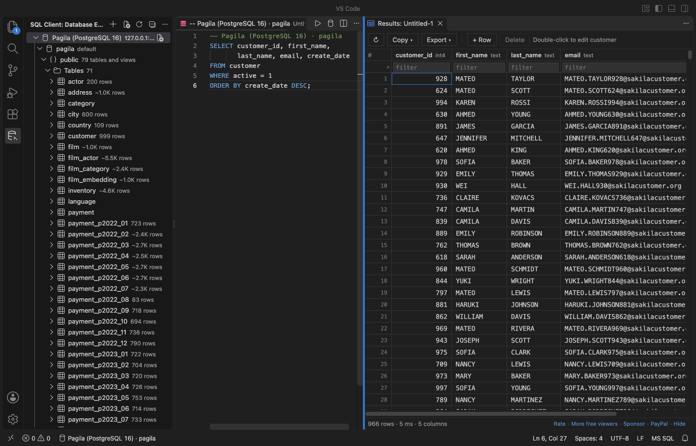
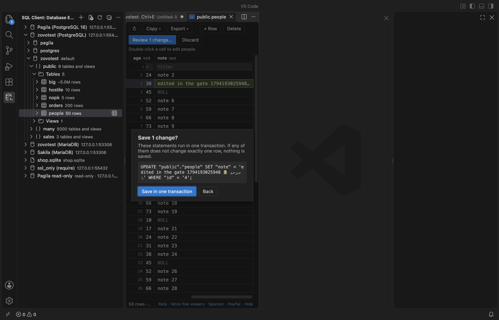
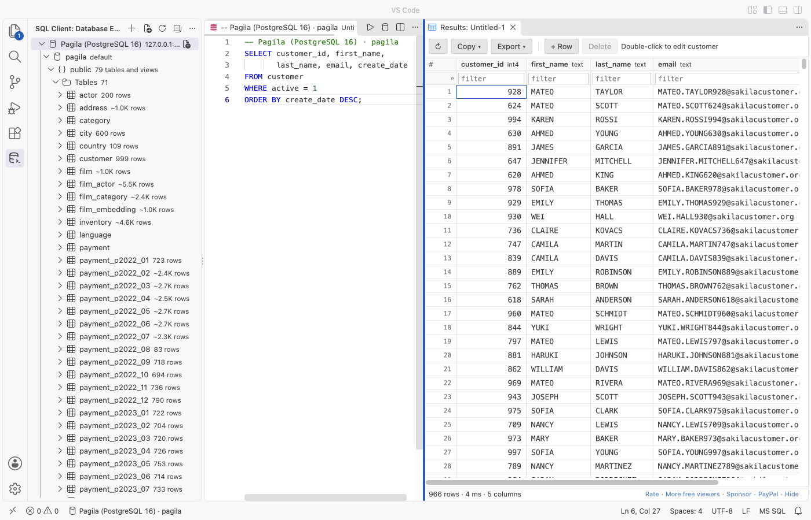

# Postgres & MySQL Query Client, a SQL Database Tool for VS Code

A free PostgreSQL client and MySQL client, with unlimited connections, free row edits and streamed CSV export. Also MariaDB and SQLite. Press Ctrl+Enter (Cmd+Enter on macOS) to run SQL. No sign-in and no subscription.

Optional Zovo Pro (USD 19 once, every Zovo extension) adds an ER diagram, schema compare, CSV import and a query library. Everything that is free today stays free.

Network: the extension connects only to the database servers you add. It sends no telemetry, makes no update check and calls no license server. It never runs a keep-alive or polling query, so your database sees nothing while you are idle. Passwords go to VS Code's secret storage, never to settings or logs.

## Why this one

Measured against the complaints in reviews of other database extensions on the Marketplace (dates are review dates):

| Complaint in reviews | Here |
|---|---|
| "It allows only 2 connections before forcing you to pay annual subscription" ([review, 2025-01-08](https://marketplace.visualstudio.com/items?itemName=cweijan.vscode-postgresql-client2&ssr=false#review-details)) | Unlimited connections, free. The gate test used 7 connections on one machine. |
| "now you can not even edit a table without paying" ([review, 2025-12-26](https://marketplace.visualstudio.com/items?itemName=DBCode.dbcode&ssr=false#review-details)) | Editing rows is free: edit a cell, add or delete a row. You see the exact SQL first, and it runs in one transaction. |
| "this will automatically run 'SELECT 1' statements to ensure that it remains connected" ([review, 2026-02-05](https://marketplace.visualstudio.com/items?itemName=DBCode.dbcode&ssr=false#review-details)) | No keep-alive and no polling. In the gate test, the PostgreSQL and MariaDB statement logs showed 0 statements in 60 idle seconds while the extension had connections open. |
| "a subscription makes it an immediate no-go. Maybe worth it if it was a one time purchase" ([review, 2025-11-07](https://marketplace.visualstudio.com/items?itemName=cweijan.vscode-postgresql-client2&ssr=false#review-details)) | No subscription. Everything above is free. Four extra tools are Zovo Pro: USD 19, paid once. |

## Features (free)

- Connections: PostgreSQL (`pg` driver), MySQL and MariaDB (`mysql2` driver), and SQLite files. Paste a `postgres://` or `mysql://` URL, or fill in the form: host, port, user, database and SSL mode (disable, prefer, require, verify-ca or verify-full, with an optional CA file). Use "Test connection" before you save.
- Database Explorer: connections, databases, schemas, tables, views, columns with types and keys, indexes and estimated row counts. Each level loads when you open it, so a schema with 5,000 tables opens in one query.
- Query editor: any `.sql` file runs on the connection shown in the status bar.
  - Ctrl+Enter runs the statement at the cursor or the selection. Ctrl+Alt+Enter runs the whole file.
  - Each result gets its own tab, and a Messages tab lists every statement.
  - An error underlines the right place in your SQL.
  - Autocomplete knows your tables, views, columns and aliases, plus the keywords of each dialect.
- Results grid: virtual scroll, sort and filter, column resize, and copy as CSV, JSON, Markdown or tab-separated text.
  - The first 1,000 rows load at once, and scrolling down loads more.
  - When not every row is loaded, sort and filter run on the server, so a 5,000,000-row table sorts correctly.
  - Long text and binary cells open in an editor tab (JSON is formatted, binary shows as a hex dump).
- Cancel: stops the running statement on the server (`pg_cancel_backend` or `KILL QUERY`). In the gate test, a 60-second query stopped 0.13 seconds after the click.
- Edit rows: works for any table with a primary key. Double-click a cell, use + Row, or Delete. Review shows the exact `UPDATE`, `INSERT` and `DELETE` statements. They run in one transaction, and each one must change exactly one row, or nothing is saved. A result without a primary key stays read-only and says why.
- Export: CSV, JSON or SQL INSERT, for a result or a whole table. Rows stream to the file in batches. In the gate test, 5,000,000 rows exported in 5.3 seconds, and VS Code's extension host grew by less than 50 MB.
- Safety:
  - A read-only switch per connection: the server enforces it for PostgreSQL and MySQL.
  - A confirmation before an `UPDATE` or `DELETE` without `WHERE`, and before `TRUNCATE`.
  - Clear messages for a wrong password, a refused connection, a server that needs SSL or an untrusted certificate. A connection that does not answer gives up after 10 seconds instead of hanging.
- Query history per connection, kept on your computer. You can turn it off in Settings.
- Dark, light and high-contrast themes follow VS Code.

## Zovo Pro (USD 19, paid once, for every Zovo extension)

You can try each Pro tool 3 times for free. After that, one quiet message explains how to unlock it. There are no popups, ads or countdowns, and nothing above is ever locked.

- ER diagram of a schema: tables, keys and foreign-key links. Drag to arrange, then save it as SVG.
- Schema compare: two schemas side by side in VS Code's diff view, from any two connections.
- CSV import into a table: the file is read as a stream, header names are matched to columns, and rows are inserted in batches of 500.
- Query library: named queries saved on this computer that open on any connection.

Zovo Pro is USD 19 once on GitHub Sponsors (the ["$19 one time" tier](https://github.com/sponsors/theluckystrike/sponsorships?tier_id=679878)). If you bought that tier, or have a monthly sponsorship of USD 10 or more that is still running, run "Zovo: Unlock Pro with GitHub Sponsors". The "$15 one time" and "$5 a month" tiers on the same page are for Obsidian plugins and do not include Zovo Pro. No GitHub account? Send USD 19 to [paypal.com/paypalme/najzzz/19](https://www.paypal.com/paypalme/najzzz/19) with "Zovo Pro" in the note, and you get a license key by email within a day. That sends one question to GitHub and nothing else. A license key is checked on your computer.

To hide the Pro tools from menus and the command palette, set `zovoSql.showProFeatures` to `false`.

## Getting started

1. Open the SQL Client view in the activity bar and click Add Connection.
2. Paste a URL such as `postgres://me@localhost:5432/shop` or fill in the fields. Click Test connection, then Save.
3. Click New Query on the connection, type SQL and press Ctrl+Enter.
4. Click a table to browse it. Double-click a cell to edit it, and use Export to save every row.

## Settings

| Setting | Default | What it does |
|---|---|---|
| `zovoSql.rowLimit` | 1000 | Rows read per query and per Load more |
| `zovoSql.maxLoadedRows` | 100000 | Rows kept in one result (exports have no limit) |
| `zovoSql.confirmUnboundedWrites` | true | Ask before `UPDATE` or `DELETE` without `WHERE` |
| `zovoSql.connectTimeoutSeconds` | 10 | Give up connecting after this many seconds |
| `zovoSql.history` | true | Keep a local query history per connection |
| `zovoSql.sqliteMaxFileSizeMB` | 512 | SQLite files are read into memory up to this size |

## Privacy

- Connection settings (without passwords) are stored in VS Code's global storage. Passwords are stored in VS Code's secret storage, which uses the system keychain.
- The extension makes no network calls except to your database servers. The one exception is when you choose "Unlock with GitHub Sponsors": it asks GitHub one question. Monthly sponsors get one silent recheck every 30 days.
- Nothing runs while you are idle. There is no connection on startup, no keep-alive and no polling.

## Support Zovo

Zovo extensions are free, with no ads and no tracking. They are made by [theluckystrike](https://github.com/theluckystrike) on GitHub. If this one saves you time, you can support the work:

- [Sponsor on GitHub](https://github.com/sponsors/theluckystrike)
- [PayPal](https://www.paypal.com/paypalme/najzzz)
- [Follow theluckystrike on GitHub](https://github.com/theluckystrike)

## More tools by Zovo

- [SQLite Viewer & SQLite3 DB File Browser, Database Explorer](https://marketplace.visualstudio.com/items?itemName=zovo.sqlite-table-viewer) browses SQLite tables read-only and runs SELECT queries.
- [XLSX Viewer & CSV Preview for Excel, XLS & Parquet](https://marketplace.visualstudio.com/items?itemName=zovo.table-viewer-vscode) opens CSV, TSV, Excel and Parquet files as a sortable, filterable table.
- [Large JSON Viewer, JSON Browser & JSON Tree](https://marketplace.visualstudio.com/items?itemName=zovo.zovo-json-tree-viewer) shows large JSON files as a searchable tree, copies JSONPath and turns arrays of objects into a table.
- [JSONL Viewer, Large JSONL Table & NDJSON Viewer](https://marketplace.visualstudio.com/items?itemName=zovo.zovo-jsonl-viewer) opens JSONL and NDJSON files as a table, as records or as a chat view.
- [Avro Viewer, Apache Arrow Viewer & Feather Viewer](https://marketplace.visualstudio.com/items?itemName=zovo.arrow-avro-viewer) opens Avro, Arrow and Feather files as a paged table.

See [all Zovo extensions on the Marketplace](https://marketplace.visualstudio.com/publishers/zovo).

## License

MIT. Drivers: [pg](https://github.com/brianc/node-postgres) (MIT), [mysql2](https://github.com/sidorares/node-mysql2) (MIT), [sql.js](https://github.com/sql-js/sql.js) (MIT). See THIRD-PARTY-NOTICES.md.
